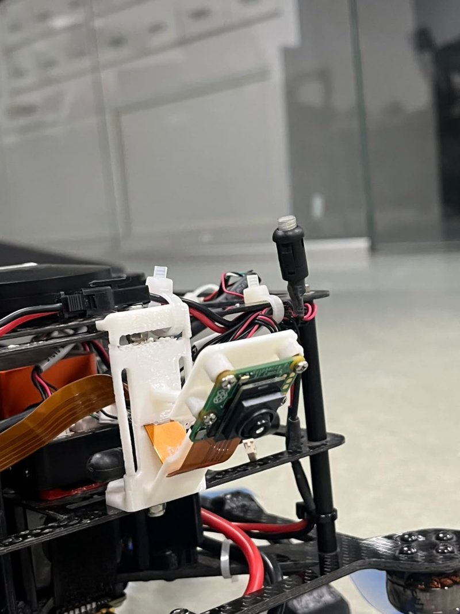
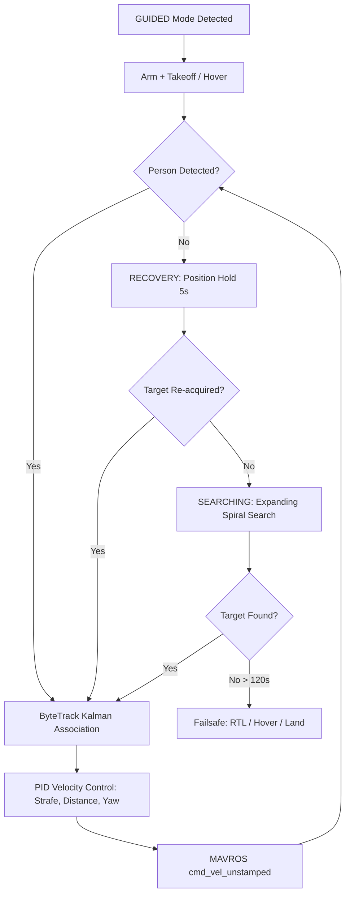
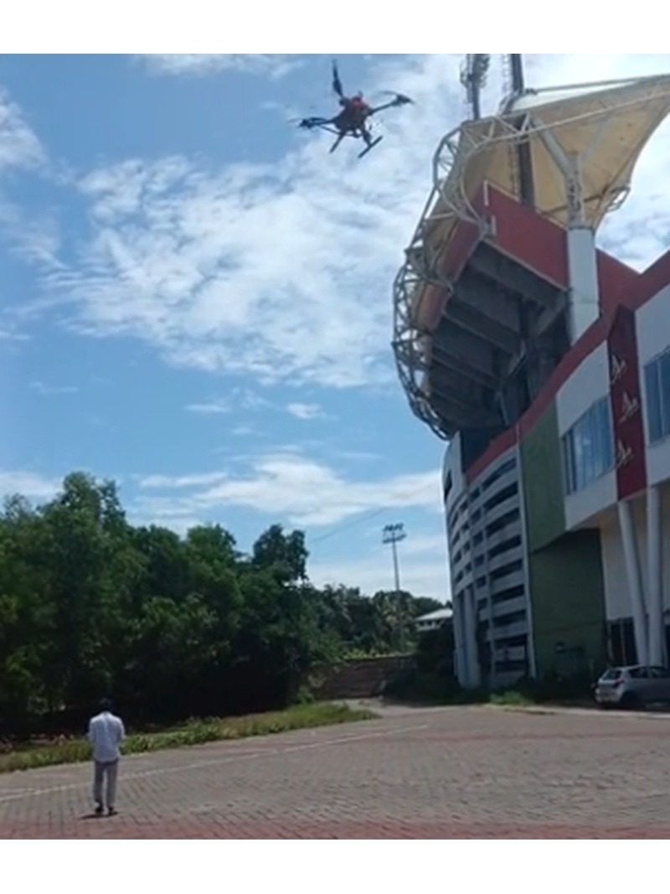
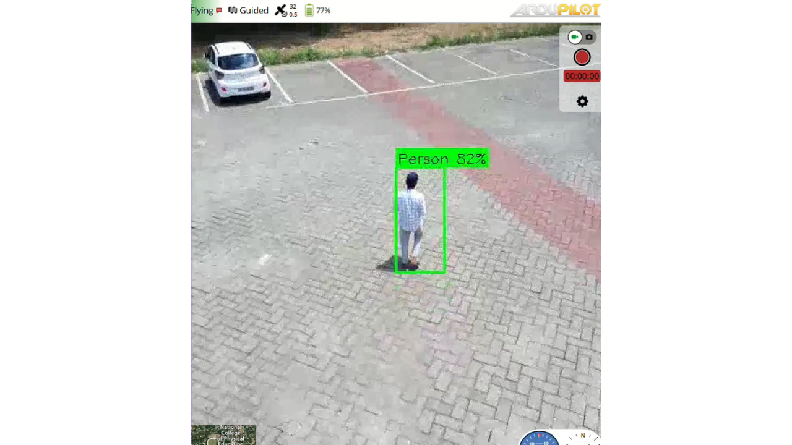
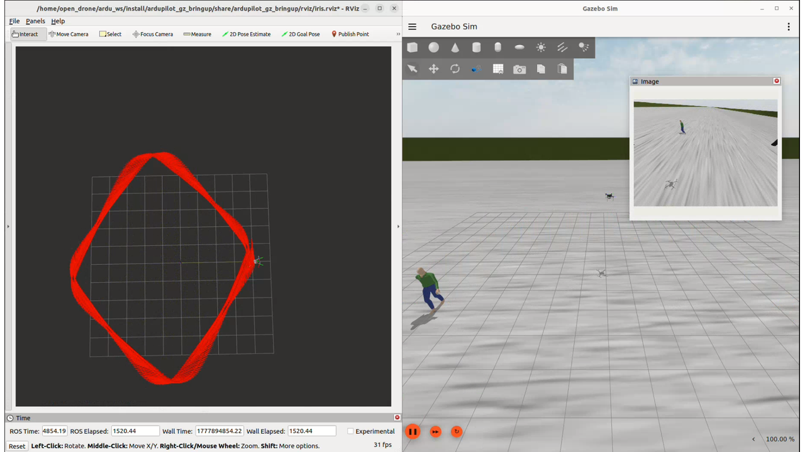
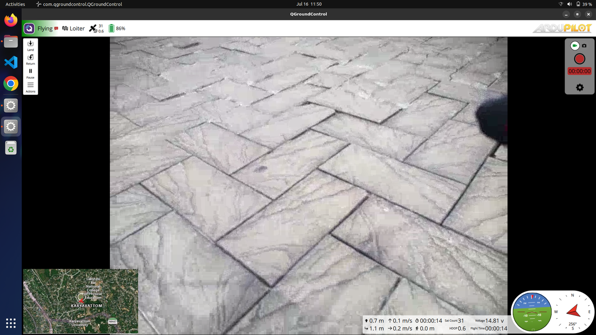

# Vision-Based Autonomous Human Tracking Drone (ROS 2 & ArduPilot)

Autonomous person following, target re-acquisition, and dynamic velocity tracking for ArduCopter, built on ROS 2 Humble and MAVROS. The system runs on a Raspberry Pi 5 equipped with a Sony IMX500 on-sensor AI camera (mounted with a 45° forward-downward tilt) and a Cube Orange+ flight controller.

> **Read [SAFETY.md](SAFETY.md) before you power the drone.** When this stack is active, switching the flight controller to **GUIDED** mode **arms the vehicle, takes off, and initiates autonomous human tracking**.

Developed by Abhin M for ICFOSS. Released under the MIT license.

<p align="center">
  
  <br>
  <em>Fury-based autonomous human tracking drone: Raspberry Pi 5 with Sony IMX500 AI camera (45° forward-downward tilt mount) and Cube Orange+ flight controller.</em>
</p>

## What It Does

1. **Autonomous Trigger**: Switch the RC transmitter mode switch to **GUIDED**. The flight stack verifies arming readiness and initiates tracking.
2. **On-Sensor AI Detection**: The Sony IMX500 hardware accelerator executes real-time neural network inference (MobileNetV2 SSD / NanoDet Plus / YOLO11) directly on the camera sensor at **30 FPS**, outputting 2D bounding boxes without CPU bottleneck.
3. **ByteTrack Multi-Object Association**: Detections are filtered and tracked across frames using ByteTrack and a 2D Kalman filter, maintaining persistent target IDs even through brief occlusions.
4. **Active 3D Pursuit**:
   - **Lateral Centering (Strafe PID)**: Commands body velocity $v_y$ to keep the target centered in the image frame.
   - **Longitudinal Distance Regulation (Distance PID)**: Estimates standoff distance from bounding box height $h_{box}$ and commands body velocity $v_x$ to maintain the setpoint distance (default 1.0–3.0 m).
   - **Heading Alignment (Yaw PID)**: Continuously yaws the drone nose towards the moving person.
   - **Altitude Hold**: Holds configured hover altitude (default 3.0–8.0 m AGL).
5. **Target Search & Recovery**: If the target is lost, the vehicle holds position for 5 seconds (`RECOVERY`), then initiates an autonomous expanding spiral search (`SEARCHING`). If no target is re-acquired within 120 s, failsafe triggers (**RTL** / Hover / Land).
6. **Live Ground Station Video**: Streams low-latency H.264 video with real-time tracking bounding box overlays directly to **QGroundControl (QGC)** over UDP port 5000.



## Results & Benchmarks

| AI Model Variant | Model Format | Input Resolution | On-Sensor Inference | Detection FPS |
| :--- | :---: | :---: | :---: | :---: |
| **SSD MobileNetV2 FPN-Lite** *(Default)* | `.rpk` (IMX500) | 320 × 320 | **~10.5 ms** | **30.0 FPS** |
| **NanoDet Plus** | `.rpk` (IMX500) | 416 × 416 | **~14.2 ms** | **30.0 FPS** |
| **YOLO11n Base** | `.rpk` (IMX500) | 640 × 640 | **~18.0 ms** | **25.0 FPS** |
| **YOLO26n** | OpenVINO / NCNN | 640 × 640 | ~35.0 ms (CPU) | ~15.0 FPS |

### Field Test Photos

| Outdoor Tracking Test | Target Tracking Feed | Real-Time Bounding Box |
| :---: | :---: | :---: |
|  |  |  |
| *Outdoor field flight test* | *Live camera feed with track ID* | *Bounding box detection overlay* |

<p align="center">
  
  <br>
  <em>QGroundControl live video stream verification: Pre-flight check confirming low-latency H.264 stream reception on the ground station laptop prior to arming.</em>
</p>

## System Overview

```text
Sony IMX500 AI Camera (45° Tilt)
       |
       +---> camera_publisher (Picamera2 + On-Sensor RPK Model)
                   |
                   +---> /camera/image_raw (sensor_msgs/Image) ────────+
                   |                                                   |
                   +---> /detections (vision_msgs/Detection2DArray)    |
                                |                                      v
                                v                            gst_streamer (H.264 UDP)
                     bytetrack_tracker                                 |
                                |                                      v
                                v                            QGroundControl (Port 5000)
                     /tracked_detections
                                |
                                v
                        human_tracker_pro
                   (FSM: SEARCH, TRACK, RECOVER)
                   (PID: Strafe, Distance, Yaw)
                                |
                                v
             /mavros/setpoint_velocity/cmd_vel_unstamped
                                |
       +────────────────────────+
       v
  Cube Orange+ Flight Controller <===USB===> MAVROS
  (ArduCopter GUIDED Mode)
```

## Hardware Summary

| Component | Selected Specification |
| :--- | :--- |
| **Airframe** | S500 Quadcopter with 1045 propellers |
| **Flight Controller** | Cube Orange+ running ArduCopter |
| **Companion Computer** | Raspberry Pi 5 (8 GB) running Docker & ROS 2 Humble |
| **Vision Sensor** | Sony IMX500 AI Camera (Raspberry Pi AI Camera) with on-sensor NPU |
| **Camera Mounting** | Custom 3D printed mount angled at **45° forward-downward tilt** |
| **Power Supply** | Dedicated 5V / 5A Step-down BEC regulator (separate from flight battery) |
| **Primary Telemetry** | High-power USB Wi-Fi dongle (5 GHz / 2.4 GHz) |
| **RC Transmitter** | RadioMaster TX16S (EdgeTX, configured for instant manual override) |

Details, wiring schematics, and bench setup: [docs/hardware/README.md](docs/hardware/README.md).

## Quick Start

1. Read **[SAFETY.md](SAFETY.md)** before powering motors.
2. Build and verify the hardware: [docs/hardware/README.md](docs/hardware/README.md).
3. Connect the IMX500 camera angled at 45° forward-downward.
4. Launch the human tracking stack:
   ```bash
   ros2 launch human_tracking_kf bytetrack_launch.py
   ```
5. Start live video streaming to your ground station laptop:
   ```bash
   python3 gstream_human_detection.py --ros-args -p laptop_ip:=192.168.1.100
   ```
6. Open **QGroundControl** on your laptop:
   * Navigate to **Application Settings** $
ightarrow$ **General** $
ightarrow$ **Video**.
   * Set **Video Source** to **UDP h.264 Video Stream**, Port: `5000`.
7. Verify vehicle telemetry and switch mode switch to **GUIDED** to commence tracking.

## Documentation Roadmap

Read the documentation sequentially following this guided workflow:

| Step | Document | Contents |
| :---: | :--- | :--- |
| **01** | [SAFETY.md](SAFETY.md) | **Safety First**: Pre-arm checklists, geofence, and manual RC override |
| **02** | [docs/hardware/README.md](docs/hardware/README.md) | **Hardware Setup**: Parts list, 5V/5A BEC power, CSI wiring, bench checklist |
| **03** | [docs/hardware/camera-holder/README.md](docs/hardware/camera-holder/README.md) | **Camera Mount**: 45° angled mount orientation, 3D printing guidelines |
| **04** | [docs/detection-models.md](docs/detection-models.md) | **AI Detection Models**: IMX500 on-sensor RPK firmware, benchmarks, training curves |
| **05** | [docs/tracking-algorithm.md](docs/tracking-algorithm.md) | **Tracking Algorithm**: ByteTrack association, Kalman filtering, FSM states, PID loops |
| **06** | [docs/simulation.md](docs/simulation.md) | **SITL Simulation**: Gazebo world with walking actor, RViz path tracing |
| **07** | [docs/software/README.md](docs/software/README.md) | **Software Stack**: Raspberry Pi OS, Docker container, Picamera2 post-processing |
| **08** | [docs/software/nodes.md](docs/software/nodes.md) | **ROS 2 Nodes**: `camera_publisher`, `bytetrack_tracker`, `human_tracker_pro` |
| **09** | [docs/software/config.md](docs/software/config.md) | **Configuration**: Complete parameter reference for `tracker_params.yaml` |
| **10** | [docs/gstreamer-streaming.md](docs/gstreamer-streaming.md) | **Video Streaming**: Ultra-low-latency H.264 UDP pipeline to QGroundControl |
| **11** | [docs/troubleshooting.md](docs/troubleshooting.md) | **Troubleshooting**: Diagnostic matrix for lost targets and flight oscillations |
| **12** | [docs/known-issues.md](docs/known-issues.md) | **Known Issues**: Anti-flicker caching notes and optimization log |

## Repository Layout

```text
human_tracking/
  README.md
  SAFETY.md
  gstream_human_detection.py                  H.264 UDP streamer with bounding boxes
  src/
    detection_model/
      model/                                  IMX500 .rpk, OpenVINO, and NCNN models
      src/camera_ai_start.py                  Picamera2 IMX500 node with anti-flicker cache
    human_tracking_kf/
      config/tracker_params.yaml              Master parameters (PID gains, geofence, topics)
      launch/bytetrack_launch.py              Launches tracker and flight controller nodes
      src/bytetrack_tracker.py                ByteTrack multi-object association node
      src/person_tracking.py                  FSM and 3D pursuit velocity PID controller
  docs/
    images/                                   Standardized documentation figures
    hardware/                                 Hardware wiring, BEC testing, camera mount
    software/                                 Node interfaces, configuration, Docker setup
```

## License

MIT, see [LICENSE](LICENSE).

---

<div align="center">

| 📖 Documentation Guide | ➡️ [**Start Step 01: Safety Guide (SAFETY.md)**](SAFETY.md) |
| :---: | :---: |

</div>
