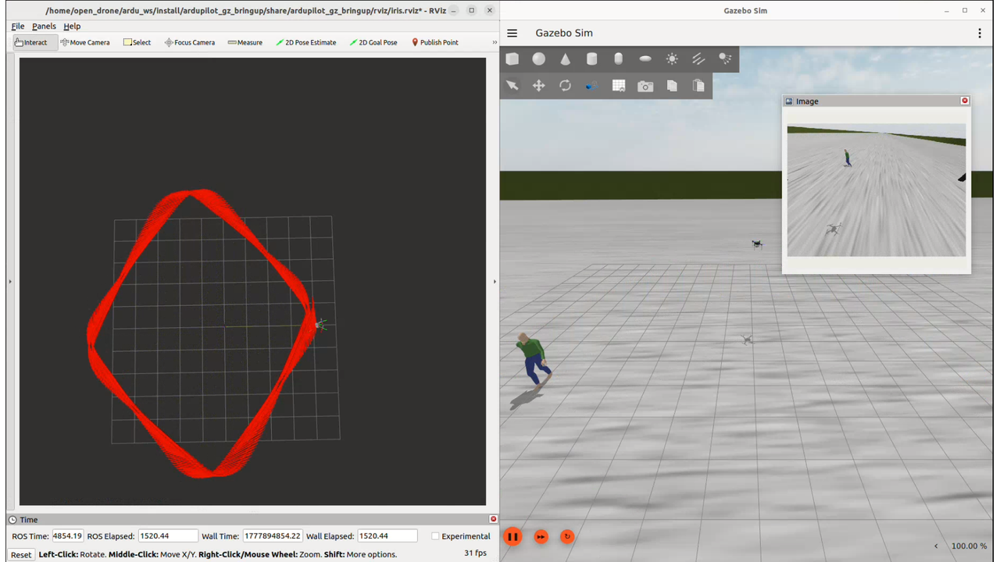
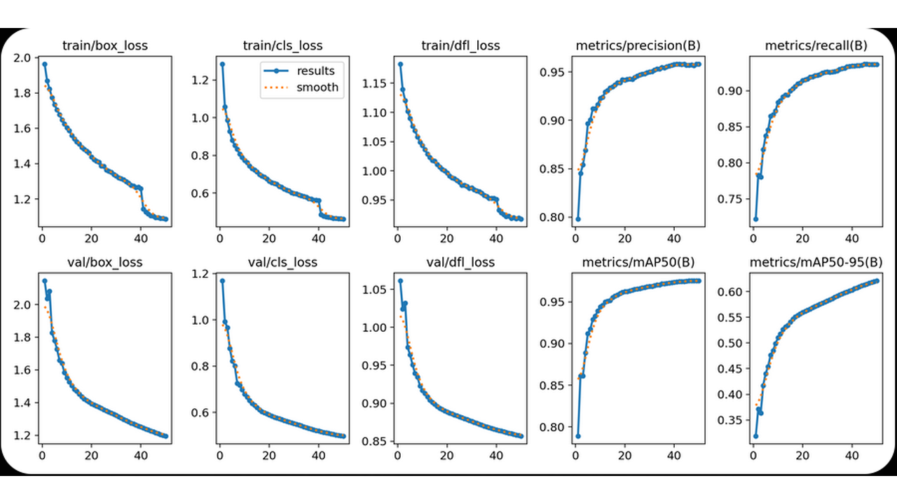

# IMX500 On-Sensor AI Detection Models

Overview of neural network models compiled for on-sensor execution on the Sony IMX500 intelligent vision sensor.



*Real-time person bounding box detection with high confidence scores.*

## The Sony IMX500 Edge AI Sensor

The Sony IMX500 integrates an image sensor with an on-chip hardware neural network accelerator. Unlike traditional pipelines where image frames are transferred across the CSI bus into the Raspberry Pi 5 CPU/GPU for inference, the IMX500 performs deep learning inference **directly on the sensor silicon**:
* **Zero Host CPU Load**: The Pi 5 CPU remains completely free for ByteTrack, Kalman filtering, and MAVROS 20 Hz control loops.
* **High Frame Rates**: Sustained 30 FPS inference with single-digit millisecond latency.
* **Compact Payload**: Pre-quantized `.rpk` firmware packages loaded at boot time.

## Available Model Firmware (`src/detection_model/model/`)

| Model Package | Resolution | Architecture | Latency | Primary Use Case |
| :--- | :---: | :---: | :---: | :--- |
| **`imx500_network_ssd_mobilenetv2_fpnlite_320x320_pp.rpk`** | 320 × 320 | MobileNetV2 SSD | **10.5 ms** | **Default flight model**: Ultra-low latency, robust 30 FPS tracking |
| **`imx500_network_nanodet_plus_416x416_pp.rpk`** | 416 × 416 | NanoDet-Plus | 14.2 ms | Enhanced accuracy for distant targets at high altitudes |
| **`yolo11n_base.rpk`** | 640 × 640 | YOLO11 Nano | 18.0 ms | State-of-the-art Ultralytics object detection |
| **`yolo11s_base.rpk`** | 640 × 640 | YOLO11 Small | 26.5 ms | Higher capacity feature extractor |
| **`custom_model_0.03.rpk` / `0.05.rpk`** | 320 × 320 | Custom Fine-Tuned | 11.0 ms | Fine-tuned on aerial drone perspectives |

## Model Training & Evaluation Curves

Models fine-tuned for aerial human tracking are evaluated across bounding box regression loss, classification loss, and mAP:



*Training loss curves and validation metrics (mAP50, mAP50-95).*

## Anti-Flicker Detection Caching

In edge robotics, single-frame inference drops or lighting fluctuations can cause standard detector nodes to publish empty messages, triggering accidental lost-target states. 

The `camera_ai_start.py` node implements **anti-flicker detection caching**:
```python
# When imx500.get_outputs() returns None (inference frame not yet available),
# the node reuses the cached previous valid detection rather than publishing empty.
if detections is None and self._cached_detections is not None:
    detections = self._cached_detections
```
This guarantees consistent tracking inputs for the downstream Kalman filter.

---

<div align="center">

| [⬅️ Previous: **03 - Camera Holder Mount**](hardware/camera-holder/README.md) | [📖 **Documentation Roadmap**](../README.md#documentation-roadmap) | [➡️ Next: **05 - Tracking Algorithm**](tracking-algorithm.md) |
| :--- | :---: | ---: |

</div>
