# IMX500 45° Camera Mount

A dedicated 3D printed mounting fixture engineered to hold the Sony IMX500 AI camera securely on the drone frame at an exact **45° forward-downward tilt**.

  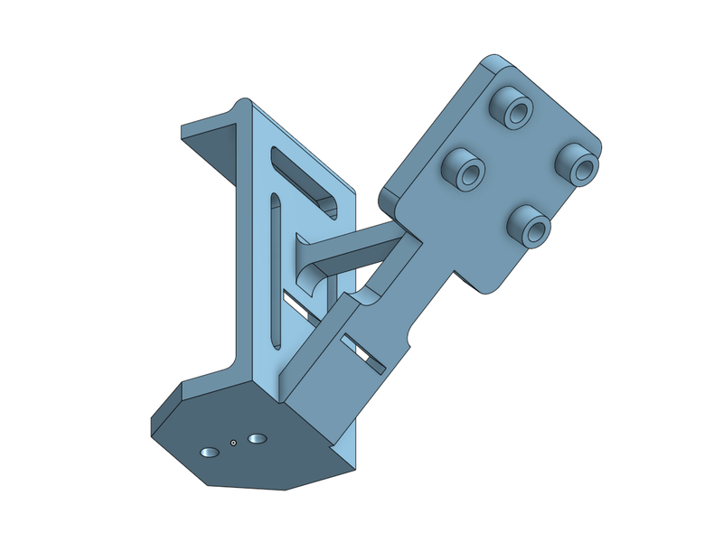
   
  <em>CAD model of the 45° forward-downward camera mounting bracket.</em>

## Why 45° Forward-Downward Tilt?

In human tracking, an angled camera orientation is optimal for drone following:
1. **Vertical Target Inclusion**: When the drone hovers at an operating altitude of 3–8 meters, a horizontal ($0^\circ$) camera would miss the person below, while a straight-down ($90^\circ$ nadir) camera would only see the crown of the person's head (making feature-based detection and posture recognition fail).
2. **Optimal Standoff Projection**: At 45°, the optical axis naturally intersects the ground 3–8 meters in front of the vehicle, providing a full-body view of standing, walking, and running humans.

## Mount Geometry & CAD Renders

Designed in CAD with integrated mounting points and cable relief:

### Multi-View CAD Renders

| Isometric View | Front View | Side View |
| :---: | :---: | :---: |
|  | 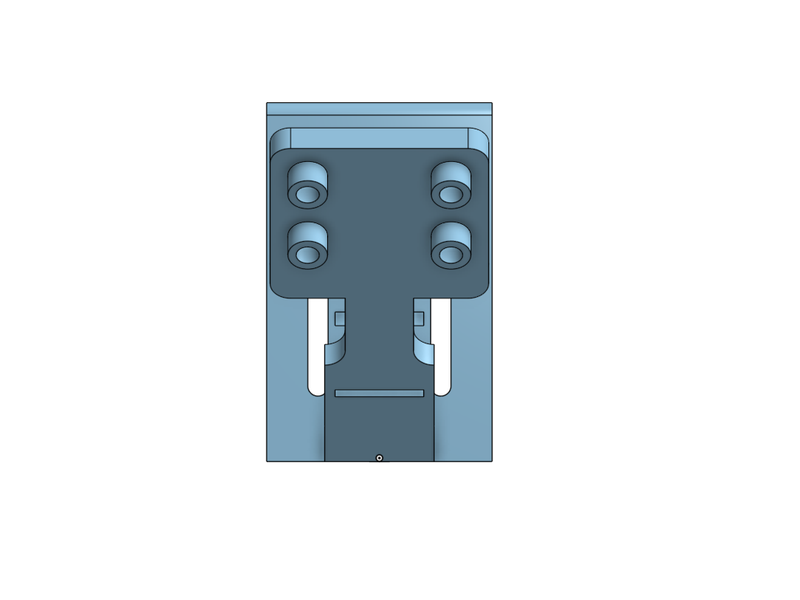 | 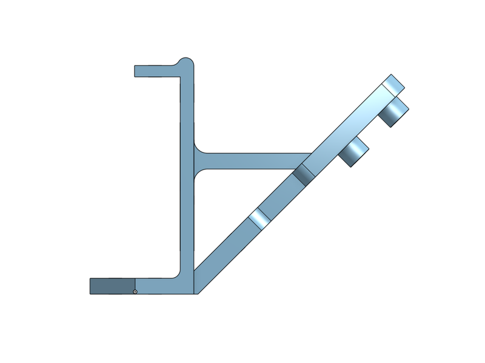 |

| Top View | Bottom View |
| :---: | :---: |
| 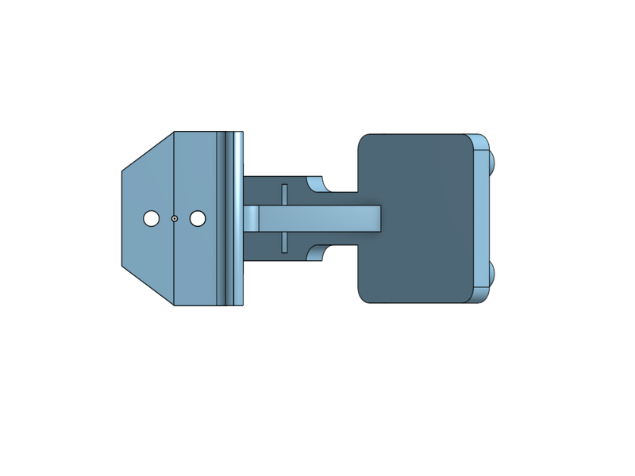 | 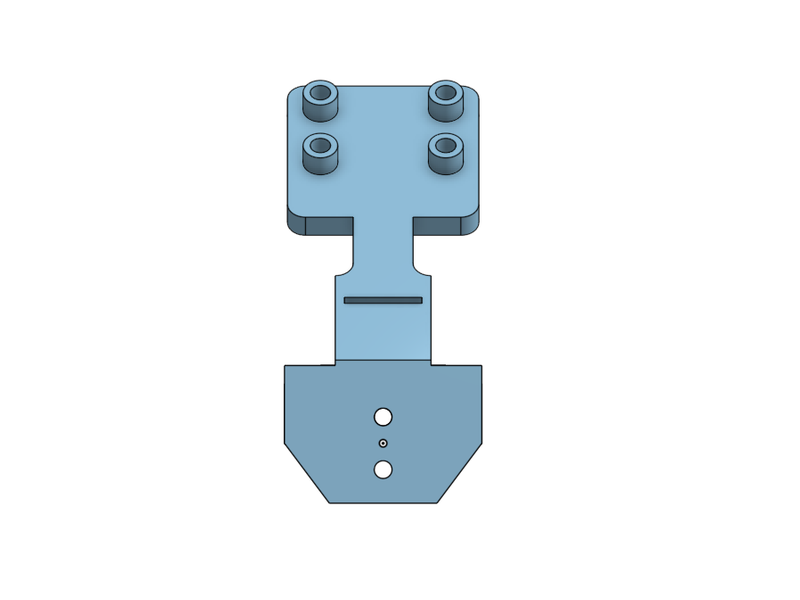 |

## CAD Files & 3D Printing

| File | Type | Description |
| --- | :---: | --- |
| [`cad/imx500_tracking_45degree_holder.stl`](cad/imx500_tracking_45degree_holder.stl) | Mesh | Print-ready STL mesh model |
| [`cad/imx500_tracking_45degree_holder.step`](cad/imx500_tracking_45degree_holder.step) | Solid | Editable STEP CAD solid model |

### Recommended Print Settings
* **Material**: PETG or ABS (recommended for outdoor UV and motor vibration resistance).
* **Layer Height**: 0.20 mm.
* **Infill**: 30% gyroid or grid.
* **Perimeters**: 4 walls for rigid structural integrity.
* **Supports**: Normal supports touching buildplate.

## Step-by-Step Physical Assembly Guide

| Sequence | Assembly Photo | Instructions |
| :---: | :---: | :--- |
| **Step 01** | 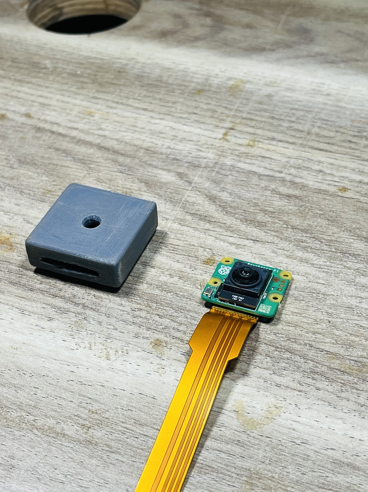 | **Prepare Sensor**: Inspect the Sony IMX500 AI camera module and verify that the lens is clean and scratch-free. |
| **Step 02** | 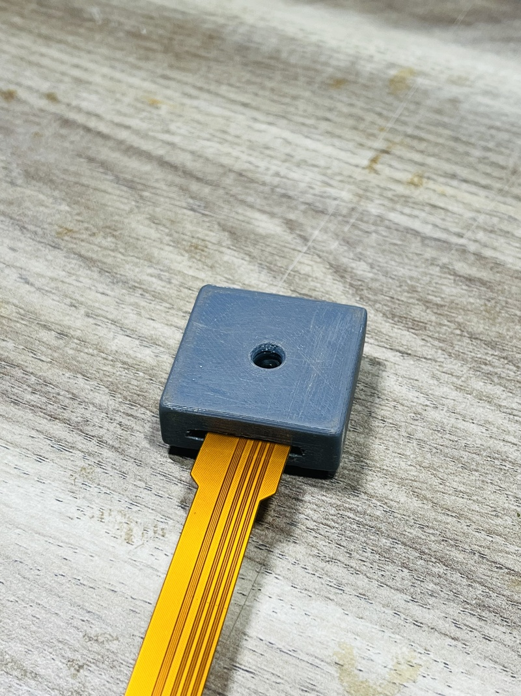 | **Case Alignment**: Fit the IMX500 PCB into the protective casing recess, aligning mounting screw standoffs. |
| **Step 03** | 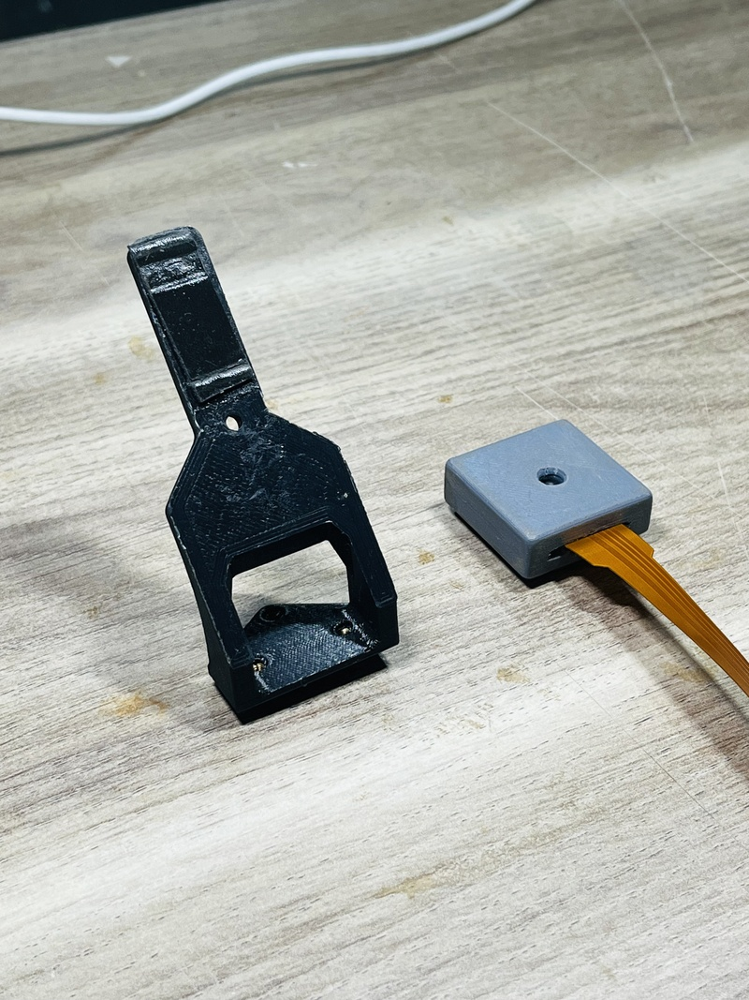 | **Inspect 45° Bracket**: Check the 3D-printed 45° stand for flat mating surfaces and clean bolt holes. |
| **Step 04** | 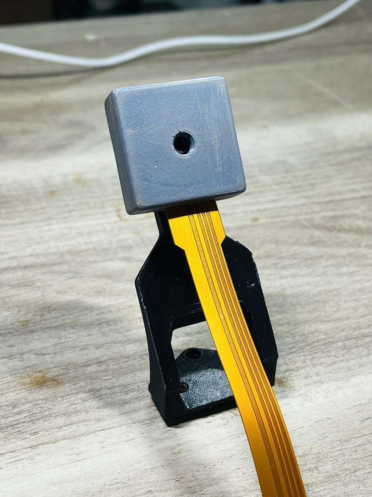 | **Secure Camera to 45° Stand**: Fasten the camera casing onto the angled face of the 3D printed mount. |
| **Step 05** | 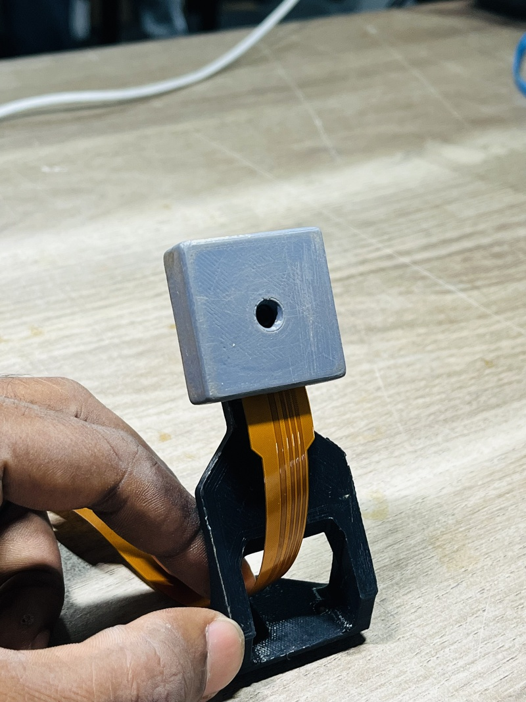 | **Route CSI Ribbon Cable**: Connect the FPC ribbon cable smoothly through the rear strain-relief slot without sharp kinks. |
| **Step 06** | 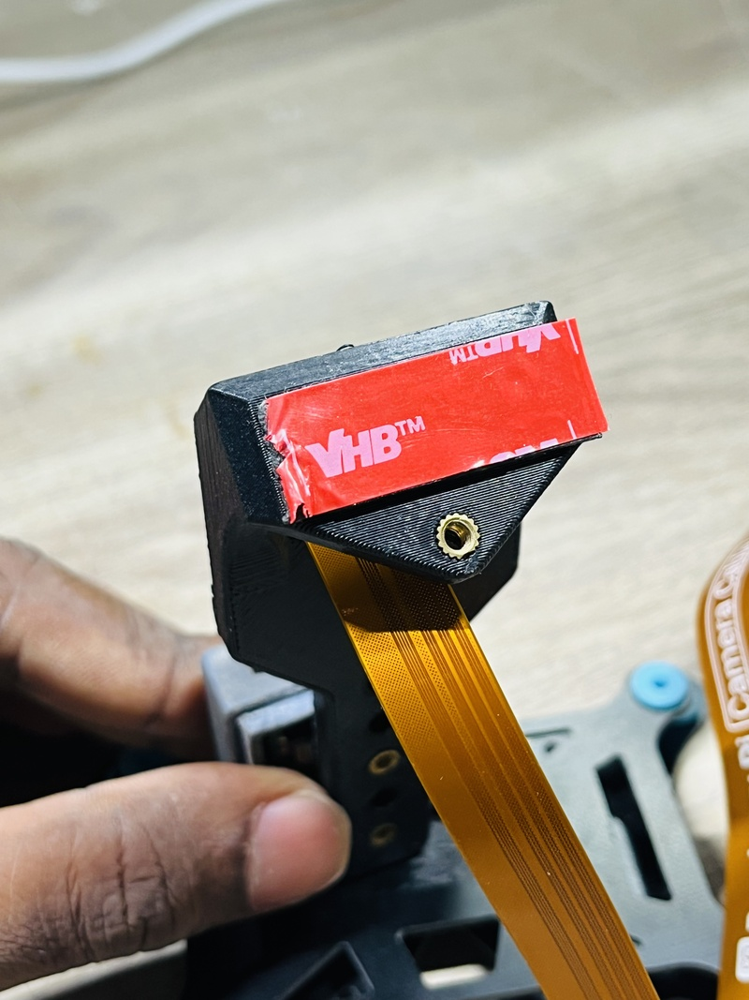 | **Base Mounting Preparation**: Apply high-adhesion double-sided mounting tape to the base plate of the stand. |
| **Step 07** | 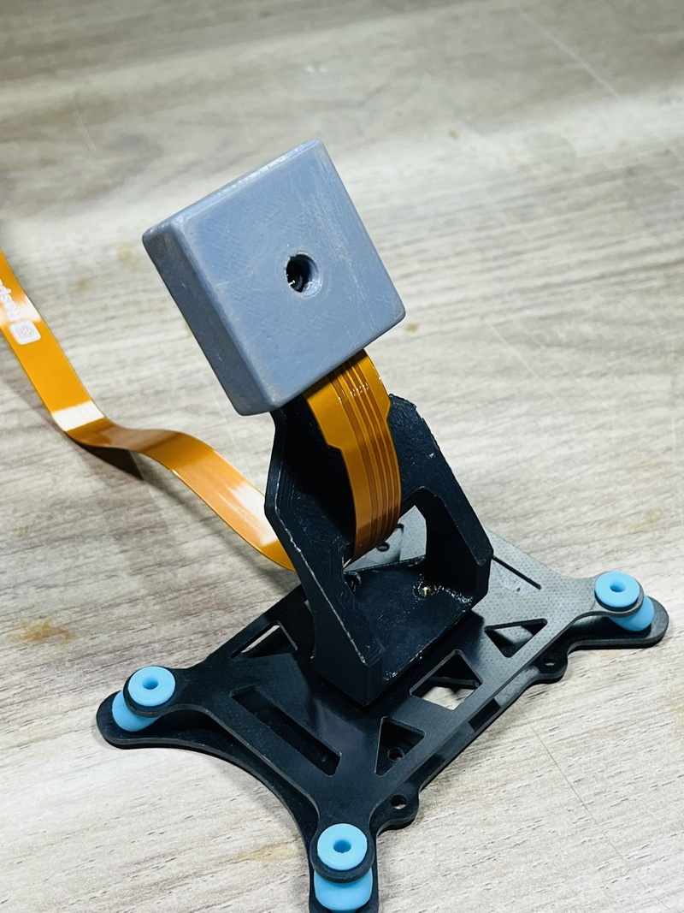 | **Vibration Damper Integration**: Affix the camera stand firmly to the vibration dampening plate on the drone frame. |

---

| [⬅️ Previous: **02 - Hardware Setup**](../README.md) | [📖 **Documentation Roadmap**](../../../README.md#documentation-roadmap) | [➡️ Next: **04 - AI Detection Models**](../../detection-models.md) |
| :--- | :---: | ---: |

