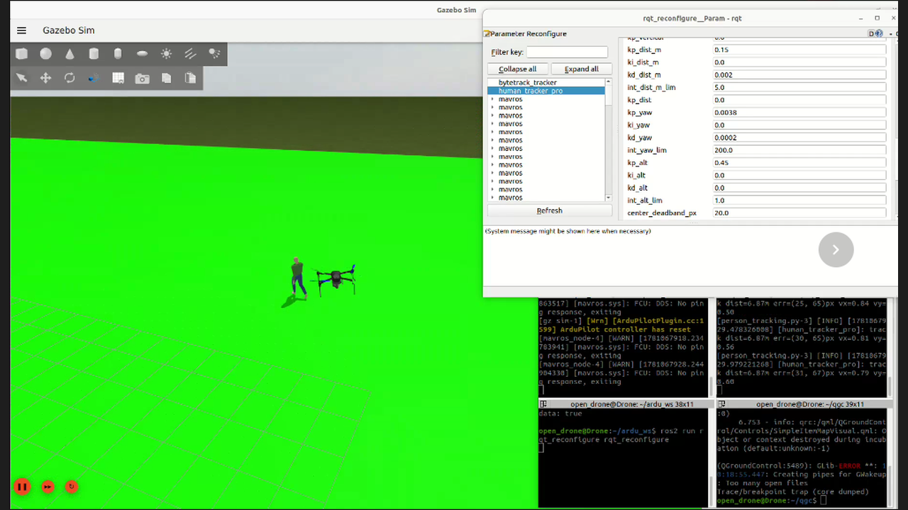
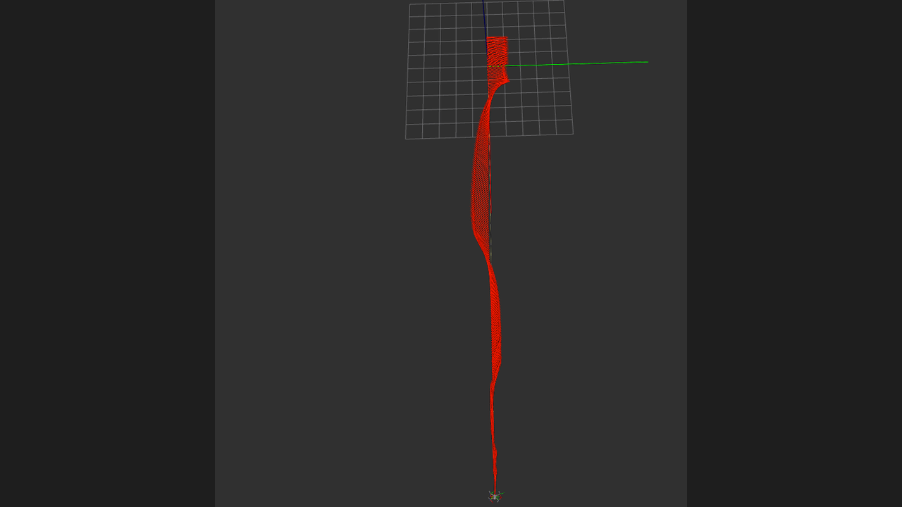
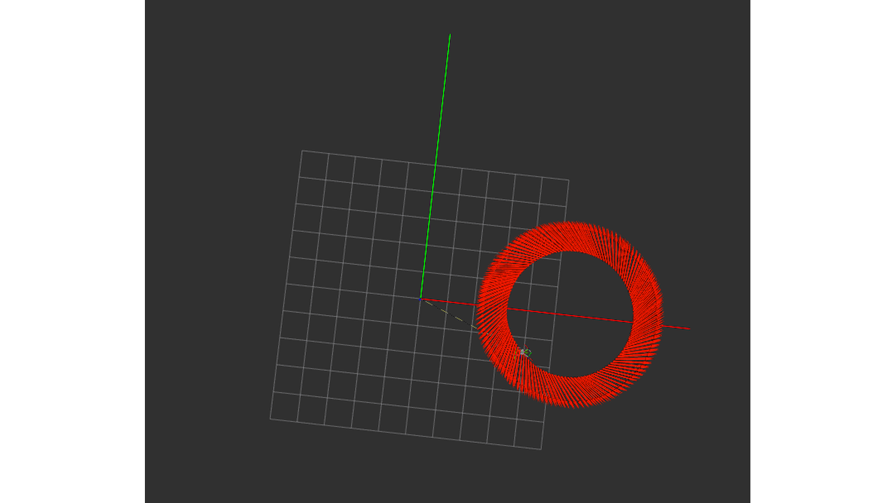

# Software-in-the-Loop (SITL) Simulation

Validate autonomous human tracking in Gazebo simulation before deploying on physical drone hardware.



*S500 Quadcopter tracking a walking human actor in the Gazebo virtual world.*

## Simulation Architecture

* **ArduCopter SITL**: Simulates vehicle dynamics, EKF3 state estimation, and GUIDED mode flight controller behavior.
* **Gazebo Simulator**: Simulates the 3D environment, physics, camera sensor plugin, and animated walking human actor (`walking_man_circle`).
* **ROS 2 & MAVROS**: Connects the simulation to the identical production flight stack.

## 1. Start SITL and Gazebo

```bash
cd ~/ardupilot/ArduCopter
sim_vehicle.py -v ArduCopter -f gazebo-iris --model JSON --map --console
```

## 2. Launch the Tracking Stack

Launch the stack with simulation time enabled and optionally spawn the walking actor:

```bash
ros2 launch human_tracking_kf bytetrack_launch.py \
    use_sim_time:=true \
    spawn_actor:=true \
    actor_sdf:=/path/to/walking_actor.sdf
```

| RViz Real-Time Trajectory Path | Odometry Verification Plot |
| :---: | :---: |
|  |  |
| *RViz path trace of drone following human actor* | *Odometry comparison: vehicle path vs human trajectory* |

## Verification Checklist

- [ ] Gazebo camera publishes `/camera/image` at $\ge 20	ext{ Hz}$
- [ ] Bounding boxes appear on `/detections`
- [ ] ByteTrack assigns and holds a persistent track ID on `/tracked_detections`
- [ ] Vehicle takes off in GUIDED mode and maintains configured standoff distance
- [ ] When target stops, drone halts and transitions to stable hover
- [ ] When target moves out of view, drone engages RECOVERY hold and then spiral search

---

<div align="center">

| [⬅️ Previous: **05 - Tracking Algorithm**](tracking-algorithm.md) | [📖 **Documentation Roadmap**](../README.md#documentation-roadmap) | [➡️ Next: **07 - Software Stack & Docker**](software/README.md) |
| :--- | :---: | ---: |

</div>
