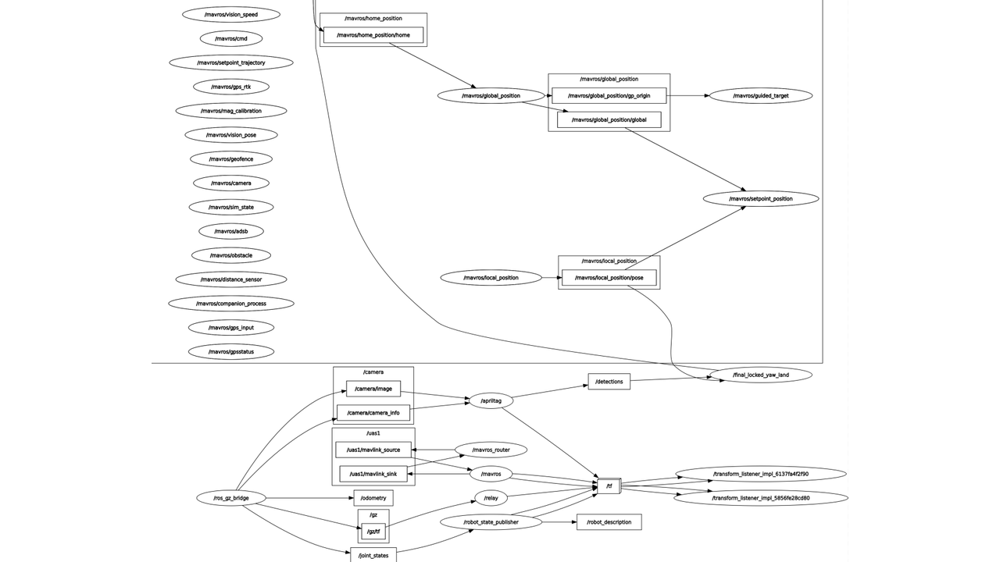

# ROS 2 Nodes & Interfaces

Detailed interface specification for the nodes in the `detection_model` and `human_tracking_kf` packages.

  
   
  <em>Computation graph showing sensor pipelines, tracker nodes, and MAVROS setpoint publishers.</em>

## Node Summary

| Node Name | Package | Executable File | Key Function |
| :--- | :--- | :--- | :--- |
| `camera_publisher` | `detection_model` | `src/camera_ai_start.py` | Interfaces with IMX500 sensor, executes RPK model, publishes images & detections |
| `bytetrack_tracker` | `human_tracking_kf` | `src/bytetrack_tracker.py` | Associates detections across frames using ByteTrack, assigns persistent IDs |
| `human_tracker_pro` | `human_tracking_kf` | `src/person_tracking.py` | State machine (SEARCH/TRACK/RECOVER), calculates velocity setpoints via PID |
| `gst_streamer` | *(Standalone)* | `gstream_human_detection.py` | Streams H.264 video with bounding box overlays to QGroundControl |

## Topic Interfaces

### Subscribed Topics

| Topic | Type | Source Node | Purpose |
| :--- | :--- | :--- | :--- |
| `/camera/image_raw` | `sensor_msgs/Image` | `camera_publisher` | Raw video frames from camera |
| `/detections` | `vision_msgs/Detection2DArray` | `camera_publisher` | Raw bounding boxes and confidence scores from IMX500 |
| `/tracked_detections` | `vision_msgs/Detection2DArray` | `bytetrack_tracker` | Filtered detections with persistent track IDs |
| `/mavros/state` | `mavros_msgs/State` | `mavros` | Flight controller arming status and flight mode |
| `/mavros/local_position/pose` | `geometry_msgs/PoseStamped` | `mavros` | Vehicle position and altitude feedback |

### Published Topics

| Topic | Type | Publisher Node | Purpose |
| :--- | :--- | :--- | :--- |
| `/mavros/setpoint_velocity/cmd_vel_unstamped` | `geometry_msgs/Twist` | `human_tracker_pro` | 20 Hz body velocity commands ($v_x, v_y, v_z, \dot{\psi}$) |
| `/bytetrack_debug` | `sensor_msgs/Image` | `bytetrack_tracker` | Optional debug image with IDs and bounding boxes |

---

| [⬅️ Previous: **07 - Software Setup**](README.md) | [📖 **Documentation Roadmap**](../../README.md#documentation-roadmap) | [➡️ Next: **09 - Configuration Parameters**](config.md) |
| :--- | :---: | ---: |

