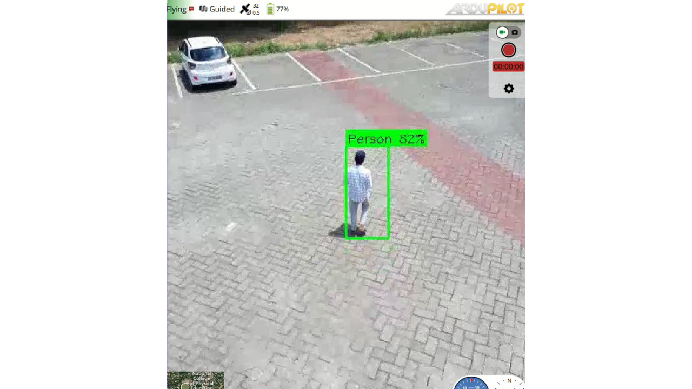
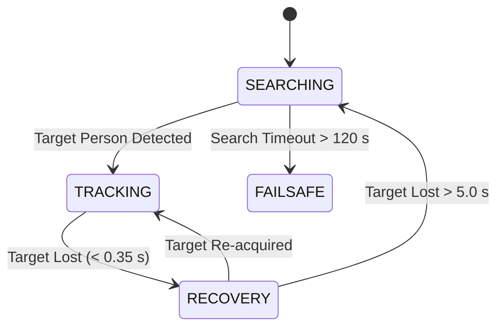

# ByteTrack Association & 3D Flight Control

Complete technical explanation of the multi-object tracker, Kalman filter state estimation, and pursuit PID velocity controllers.

*Live bounding box and trajectory tracking.*

## 1. ByteTrack Association

The `bytetrack_tracker.py` node receives raw 2D detections and implements the ByteTrack algorithm:
* **Two-Stage Association**:
  1. High-confidence detections ($conf \ge 0.40$) are matched with existing active tracks using IoU (Intersection over Union).
  2. Unmatched tracks are re-evaluated against lower-confidence detections ($conf \ge 0.10$), recovering targets during brief partial occlusions or motion blur without admitting false positives.
* **Persistent ID Assignment**: Each person receives a unique ID, ensuring the drone stays locked onto the designated target even when other people cross the camera view.

## 2. Finite State Machine (FSM)

The flight controller (`person_tracking.py`) operates a robust 3-state machine:

| State | Purpose | Vehicle Behaviour |
| :--- | :--- | :--- |
| **`SEARCHING`** | Acquire or locate target | Flies an autonomous expanding spiral or yaw rotation (`search_speed: 0.3 m/s`, `spiral_growth: 0.1 m/s`) |
| **`TRACKING`** | Active person pursuit | Executes multi-axis PID loops to regulate centering, distance, heading, and altitude |
| **`RECOVERY`** | Temporary occlusion buffer | Holds position for 5.0 s while maintaining camera heading to wait for target re-emergence |

## 3. Distance Estimation via Pinhole Geometry

With the camera pitched at an angle $	heta = 45^\circ$, target distance is estimated using pinhole perspective geometry based on expected human height $H_{person} = 1.70	ext{ m}$ and calibrated focal length $f_{px} = 460.64	ext{ px}$:

$$d_{est} = rac{H_{person} \cdot f_{px}}{h_{box} \cdot \cos(45^\circ)}$$

where $h_{box}$ is the detected bounding box height in pixels.

## 4. Multi-Axis PID Control

The controller computes velocity setpoints at 20 Hz published to `/mavros/setpoint_velocity/cmd_vel_unstamped`:

1. **Lateral Centering (Strafe PID)**:
   $$e_x = c_x - x_{target}$$
   $$v_y = k_{p,	ext{strafe}} \cdot e_x + k_{d,	ext{strafe}} \cdot \dot{e}_x \quad (	ext{clamped to } \pm 0.6	ext{ m/s})$$

2. **Longitudinal Standoff (Distance PID)**:
   $$e_{dist} = d_{est} - d_{target}$$
   $$v_x = k_{p,	ext{dist}} \cdot e_{dist} + k_{d,	ext{dist}} \cdot \dot{e}_{dist} \quad (	ext{clamped to } \pm 0.6	ext{ m/s})$$

3. **Heading Alignment (Yaw PID)**:
   $$\dot{\psi} = k_{p,	ext{yaw}} \cdot e_x + k_{d,	ext{yaw}} \cdot \dot{e}_x \quad (	ext{clamped to } \pm 0.5	ext{ rad/s})$$

4. **Altitude Hold (Altitude PID)**:
   $$e_z = z_{target} - z_{current}$$
   $$v_z = k_{p,	ext{alt}} \cdot e_z \quad (	ext{clamped to } \pm 0.5	ext{ m/s})$$

5. **Velocity Smoothing**: Acceleration limiting ($a_{max} = 0.5	ext{ m/s}^2$) prevents abrupt jerky flight.

---

| [⬅️ Previous: **04 - AI Detection Models**](detection-models.md) | [📖 **Documentation Roadmap**](../README.md#documentation-roadmap) | [➡️ Next: **06 - SITL Simulation**](simulation.md) |
| :--- | :---: | ---: |

